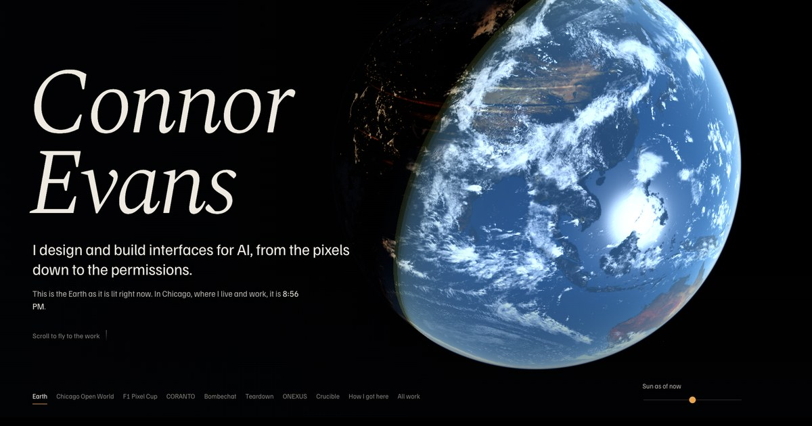
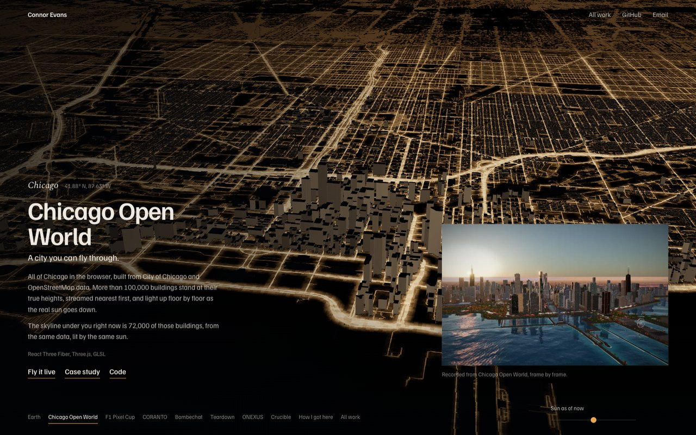
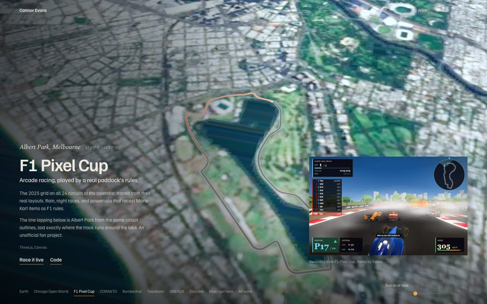

# Connor Evans, portfolio

My portfolio is a flight around the real Earth. Each project sits where it belongs: Chicago Open World over the Loop, F1 Pixel Cup at Albert Park, CORANTO over Victoria Harbour, Bombechat at Bletchley Park. The light is real: the sun is placed for the minute you open the page, so the city you land in may be at noon or at midnight.



Close to the ground, the globe hands over to real data. Chicago is USGS aerial photography with 88,000 buildings from my Chicago Open World project on top, drawn with its facade shader, lit and shadowed by the sun, and at night its streetlights are every OpenStreetMap road within ten kilometres of the Loop. Albert Park is traced from the circuit's real outline and laid where the track runs.





## How it is built

Three.js and hand-written GLSL, no framework. The Earth is one shader: Blue Marble by day, Black Marble lights by night, GEBCO relief, cloud shadows, ocean glint, and single-scattering air computed per pixel. Close-ups swap in a finely divided patch of sphere so buildings sit on the true surface, and a logarithmic depth buffer lets one scene hold both orbit and street level.

The flight between places follows the great circle and climbs with distance, so long hops rise far enough to show both ends. Scrolling sets the destination and the camera eases toward it.

The `tools/` folder rebuilds every asset from public sources: `textures.py` for the globe, `city_tiles.mjs` (buildings from Chicago Open World) and `street_lights.py` for the city, `imagery.py` for the aerial and satellite layers. `tools/shoot.mjs` screenshots each chapter from a headless browser.

## Running it

```
npm install
npm run dev
```

Add `?sun=-300` to the address to move the sun five hours back; the slider on the page does the same.

## Credits

Imagery: NASA Blue Marble, Black Marble and Visible Earth; GEBCO; USGS NAIP; Sentinel-2 cloudless by EOX IT Services (CC BY 4.0, contains modified Copernicus Sentinel data 2016); Lands Department, HKSAR Government; NASA GIBS. Data: City of Chicago, OpenStreetMap contributors (ODbL), Wikipedia, bacinger/f1-circuits (MIT), the Yale Bright Star Catalogue. The case studies under `/work` are carried over from my earlier site.
